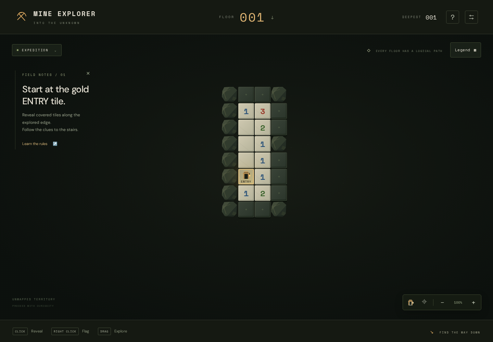
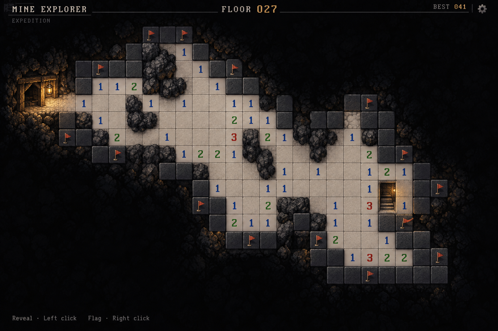

# Mine Explorer

A browser puzzle game combining classic Minesweeper deduction with endless exploration through an irregular underground mine.

**[Play Mine Explorer](https://miniqrti.github.io/Mine-explorer/)**

**Status:** live and validated through three specialist review rounds. GitHub Actions validation/deployment passed, and the published game was checked in desktop and mobile browser contexts.

**Repository:** [miniQrti/Mine-explorer](https://github.com/miniQrti/Mine-explorer), public for browser test-page hosting.

- Desktop, phone, and tablet support.
- Discover hidden stairs to descend; clearing the entire board is unnecessary.
- Fresh, logically solvable floors on every attempt.
- Expedition and floor retry modes.
- Lantern-lit pixel-art caves with readable classic number clues.
- Clearly marked entrances, a full symbol legend, and compact 9–16-tile starts.

## Run locally

Use Node.js 24 or newer:

```sh
npm ci
npm run dev
```

Open http://localhost:4173. Desktop: click to reveal, right-click to flag. Touch: tap to reveal, hold to flag, drag to pan, pinch to zoom. Keyboard: Tab into the board, arrows to navigate, Enter/Space to reveal, F to flag.

Start at the gold **ENTRY** tile and reveal covered tiles along the explored edge. **Legend** explains every map symbol. The entrance icon beside the map controls returns the view to your starting point.

Runs and separate mode records save in this browser when local storage is available. Refreshing resumes the same attempt; retrying a failed floor always creates a new cave. No account or server is required.

## Validate and build

```sh
npm test
npx playwright install chromium
npm run test:browser
npm run build
```

The build is a static site in `dist/` and uses relative asset paths for GitHub Pages. The generation worker rejects caves that cannot be solved from visible clues; it never returns an unverified fallback.

Validation results and subsequent feedback regressions are recorded in the [review board](docs/REVIEW_BOARD.md). Mobile tests use device emulation; physical-device testing is still useful. For the optional WebKit smoke suite, install Playwright WebKit and its system dependencies, keep `npm run dev` running, then run `npm run test:webkit`.

See [the design specification](docs/DESIGN.md), [review board](docs/REVIEW_BOARD.md), and [hosting instructions](docs/DEPLOYMENT.md).

## Playable build



[Mobile gameplay screenshot](docs/screenshots/mobile.png)

## Original visual direction



The concept image illustrates the appearance only. Its clue placement is not a validated puzzle.
